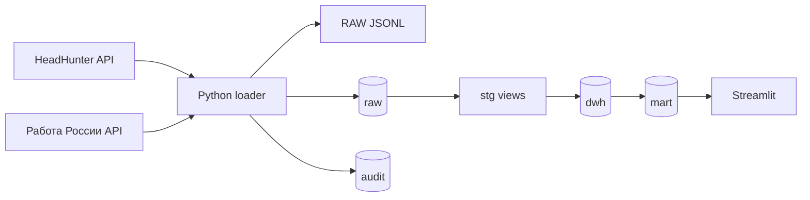

# Архитектура

Проект разделён на два контура. Python отвечает за общение с API источников,
контроль лимитов, очистку поисковой выдачи, сохранение обезличенных полей
источника и аудит запуска. PostgreSQL хранит историю, нормализует JSON и готовит
витрины для дашборда.

## Слои

- `raw` сохраняет каноническую запись и обезличенный снимок полей источника.
  Контактные поля удаляются до записи в файлы и PostgreSQL.
- `audit` хранит запуски, запросы и поисковые сегменты.
- `stg` извлекает типизированные поля из JSON.
- `dwh` содержит измерения, снимки и связи «вакансия - навык - направление».
- `mart` даёт готовые показатели для SQL-анализа и дашборда.

Актуальная витрина строится не по одному последнему запуску вообще, а по
последнему завершённому запуску каждого источника. Это позволяет одновременно
показывать данные HeadHunter и «Работы России», даже если они обновлялись в
разное время. Источник `synthetic_demo` используется только при отсутствии
живых снимков и никогда не смешивается с ними в аналитике.

Поисковая группа проекта и профессиональная роль HH - разные сущности. Группа
показывает аналитическое направление, а роль берётся из справочника источника.

## Поток одного запуска

1. Клиент получает `found` для каждого сегмента.
2. Сегмент, превысивший лимит источника, делится по датам. Для HH лимит равен
   2 000, для «Работы России» - 10 000 записей. Для одного дня дополнительно
   могут использоваться списки профессиональных ролей и регионов.
3. Если источник возвращает широкий текстовый поиск, заголовок проверяется по
   правилам сегмента. Отсеянные строки учитываются в аудите, но не попадают в RAW.
4. Каждый принятый ответ сохраняется в RAW в общей модели. Для «Работы России»
   рядом хранится исходная структура записи после удаления контактов.
5. HH-карточка запрашивается для новой или изменившейся вакансии. У «Работы
   России» полная запись уже приходит в поисковом ответе и повторно не скачивается.
   Принудительное обновление включается флагом `--refresh-details`.
6. SQL загружает измерения, связи и снимок, затем обновляются витрины.
7. Дашборд объединяет последние снимки источников и позволяет фильтровать их
   отдельно.

Оба API приводятся к одной внутренней JSON-модели. Благодаря этому SQL-слои не
зависят от названий полей конкретного источника. ID вакансий «Работы России»
получают префикс `trudvsem:`, поэтому они не могут пересечься с ID HeadHunter.
