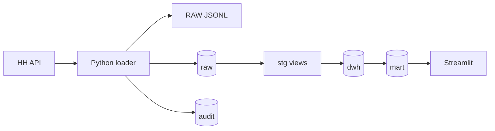

# Архитектура

Проект разделён на два контура. Python отвечает за общение с HH API, контроль
лимитов, сохранение исходных ответов и аудит запуска. PostgreSQL хранит историю,
нормализует JSON и готовит витрины для дашборда.

## Слои

- `raw` сохраняет поисковые ответы и версии детальных карточек без потери полей.
- `audit` хранит запуски, запросы и поисковые сегменты.
- `stg` извлекает типизированные поля из JSON.
- `dwh` содержит измерения, снимки и связи «вакансия - навык - направление».
- `mart` даёт готовые показатели для SQL-анализа и дашборда.

Поисковая группа проекта и профессиональная роль HH - разные сущности. Группа
показывает аналитическое направление, а роль берётся из справочника источника.

## Поток одного запуска

1. Клиент получает `found` для каждого сегмента.
2. Сегмент с числом результатов больше 2 000 делится по датам. Для одного дня
   используются заданные списки профессиональных ролей и регионов.
3. Каждый поисковый ответ сохраняется в RAW. Повторные ID не приводят к повторной
   загрузке детальной карточки.
4. Карточка запрашивается для новой или изменившейся вакансии. Принудительное
   обновление включается флагом `--refresh-details`.
5. SQL загружает измерения, связи и снимок, затем обновляются витрины.
